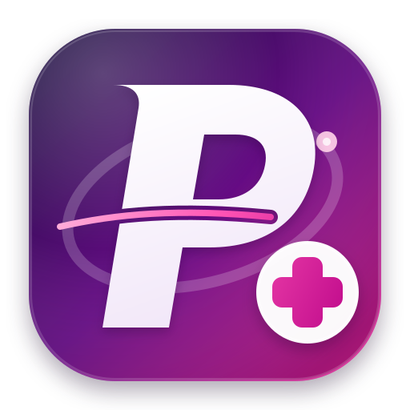
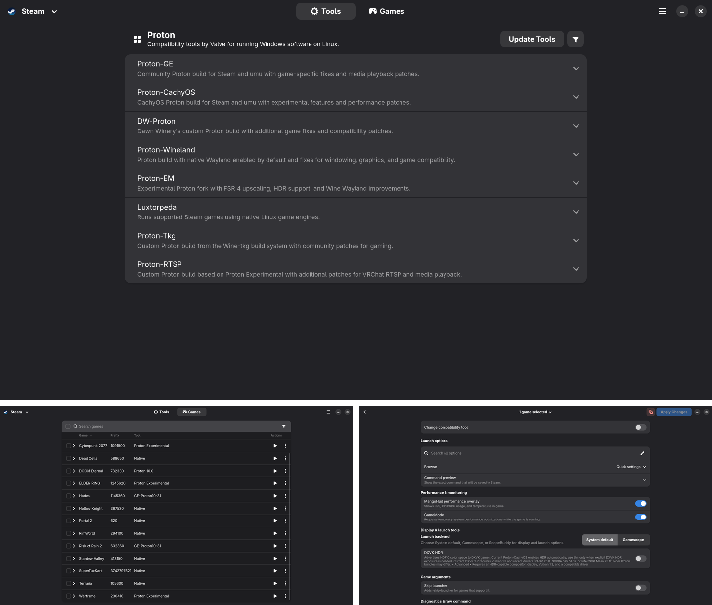

<p align="center">
  
</p>

<h1 align="center">ProtonPlus</h1>

<p align="center">
  Manage Proton, Wine, and other compatibility tools.
</p>

<p align="center">
  <strong><a href="#installation">Install</a></strong> ·
  <a href="https://github.com/Vysp3r/ProtonPlus/releases">GitHub Releases</a> ·
  <a href="docs/README.md">Documentation</a>
</p>

<p align="center">
  
</p>

- Install and update Proton, Wine, DXVK, and VKD3D for [supported launchers](docs/compatibility.md).
- Change compatibility tools and launch options for one Steam game or several at once.
- Browse and launch games from Lutris, Faugus Launcher, Heroic Games Launcher, and Bottles. Edit per-game runners in Lutris and Faugus. [Games tab guide](docs/usage.md#manage-games-in-other-launchers)
- Navigate with a gamepad.
- Search for runners, check for updates, and manage tools from the [command line](docs/usage.md#command-line-interface).

## Installation

<a href="https://flathub.org/apps/com.vysp3r.ProtonPlus">
  
</a>

Or install from the terminal.

```sh
flatpak install flathub com.vysp3r.ProtonPlus
```

For AppImage, native packages, and community packages, see the [installation guide](docs/installation.md).

## Get involved

[Contribute or build from source](CONTRIBUTING.md) · [Report an issue](https://github.com/Vysp3r/ProtonPlus/issues) · [Translate on Weblate](https://hosted.weblate.org/projects/protonplus/protonplus/) · [Donate](https://protonplus.vysp3r.com/#donate)

## License

[GPL-3.0-or-later](LICENSE.md)
